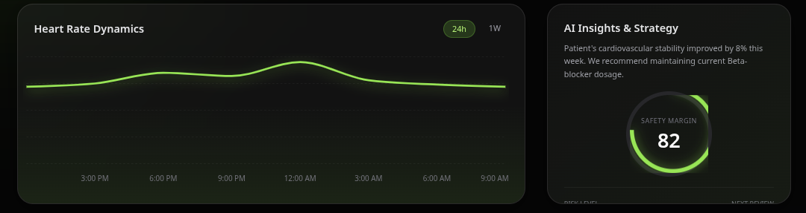
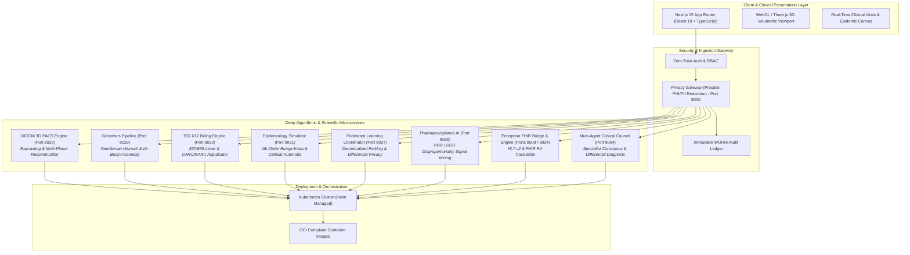

# MediAssist-AI: Enterprise Distributed Healthcare Operating System

[](https://www.typescriptlang.org/)
[-000000?style=for-the-badge&logo=next.js&logoColor=white)](https://nextjs.org/)
[](https://www.python.org/)
[](https://fastapi.tiangolo.com/)
[](https://www.docker.com/)
[](https://kubernetes.io/)
[](#microservices-ecosystem)
[](#codebase-metrics)

<div align="center">
  
  <p><em>Real-Time Ambient Clinical Intelligence, Vitals Trending & Automated Diagnostic Strategy Dashboard</em></p>
</div>

---

## 📌 Executive Overview

Modern healthcare systems are plagued by **severe technical fragmentation**:
* **Radiology PACS** exist on proprietary viewer islands detached from clinical notes.
* **Genomic Sequencing** is analyzed in offline bioinformatic clusters without real-time EHR cross-referencing.
* **Medical Billing & Revenue Cycles** remain trapped in legacy ANSI ASC X12 EDI batch files (837/835), leading to delayed claim rejections and high administrative overhead.
* **Epidemiological & Outbreak Analytics** rely on disconnected surveillance pipelines with little spatial or compartmental modeling fidelity.

**MediAssist-AI** solves this through a unified, distributed healthcare operating system and clinical intelligence platform. Built across **33 asynchronous microservices** and **52,000+ lines of strictly typed code**, it bridges deep algorithmic engineering with an ambient clinical workflow—combining real-time WebGL volumetric rendering, algorithmic sequence alignment, hierarchical EDI claim parsing, and Runge-Kutta numerical epidemiological simulation.

---

## 🏗️ High-Level System Architecture



---

## ⚡ Core Algorithmic Engines (Built From First Principles)

Rather than treating complex clinical problems as superficial wrapper scripts, MediAssist-AI implements specialized mathematical, parsing, and rendering engines directly from foundational computer science principles:

### 1. 3D Volumetric DICOM PACS Engine (`apps/dicom-pacs-engine` · Port 8028)
* **Volumetric Raymarching:** Custom WebGL fragment shaders performing raycasting through 3D voxel grids to reconstruct CT and MRI scans.
* **Transfer Functions & Hounsfield Unit Windowing:** Real-time transfer function mapping for calibrated Hounsfield Units (HU) across Bone (+1000 HU), Soft Tissue (+40 HU), and Lung (-600 HU) windows.
* **Multi-Planar Reconstruction (MPR):** Dynamic slicing along Axial, Coronal, and Sagittal orthogonal planes with interactive window/level manipulation.

### 2. Genomic Bioinformatics Pipeline (`apps/genomics-pipeline` · Port 8029)
* **Dynamic Programming Sequence Alignment:** Full, memory-efficient implementations of the **Needleman-Wunsch** global alignment algorithm and the **Smith-Waterman** local alignment algorithm featuring affine gap penalties ($Gap = Open + k \cdot Extend$).
* **K-Mer De Bruijn Graph Assembly:** High-speed K-mer hashing, Eulerian path finding, and contig generation for short-read de novo sequence assembly.
* **Finite State Machine VCF Parser:** Deterministic finite automaton (DFA) parser processing genomic Variant Call Format (VCF 4.2) records, annotating single nucleotide polymorphisms (SNPs) and structural indels.

### 3. Healthcare EDI X12 Billing & Adjudication Engine (`apps/edi-billing-engine` · Port 8030)
* **ANSI ASC X12 Lexer & State-Machine Parser:** Custom streaming lexer for variable delimiter-separated X12 segments (`*`, `:`, `~`), constructing hierarchical loop structures (`HL*1`, `HL*2`, `HL*3`) for HIPAA compliance.
* **Transaction Set 837 (Claims) & 835 (Remittance Advice):** Native bidirectional parsing and reconciliation between outpatient/inpatient billing claims and payer payment remittances.
* **Automated Adjudication Rules Matrix:** Programmatic rule validation mapping over 7,500 lines of explicit **CARC** (Claim Adjustment Reason Codes) and **RARC** (Remittance Advice Remark Codes) to detect billing fraud, underpayments, and cross-coverage discrepancies.

### 4. Agent-Based Epidemiological Outbreak Simulator (`apps/epidemiology-simulator` · Port 8031)
* **4th-Order Runge-Kutta (RK4) Numerical Integrator:** Solves systems of coupled non-linear differential equations for compartmental SEIR dynamics:
  $$\frac{dS}{dt} = -\frac{\beta S I}{N}, \quad \frac{dE}{dt} = \frac{\beta S I}{N} - \sigma E, \quad \frac{dI}{dt} = \sigma E - \gamma I, \quad \frac{dR}{dt} = \gamma I$$
* **Spatial Cellular Automata Agent Model:** Multi-agent stochastic simulation across a discrete 2D grid utilizing Moore-neighborhood transmission vectors, simulating contact tracing, quarantine mitigation, and reproductive rate ($R_0$) decay.
* **Geocoded Global Node Matrix:** Built-in spatial topology representing 3,000+ global urban nodes with real-world density and movement parameters.

### 5. Privacy-Preserving Federated Learning Coordinator (`apps/federated-learning-coordinator` · Port 8027)
* **Decentralized FedAvg:** Multi-client aggregation orchestrator allowing participating healthcare institutions to collaboratively train diagnostic models without transferring raw patient datasets.
* **Differential Privacy:** $(\epsilon, \delta)$-differential privacy noise calibration applied to gradient checkpoints prior to global weight aggregation.

### 6. Pharmacovigilance AI & Signal Detection (`apps/pharmacovigilance-ai` · Port 8026)
* **Quantitative Disproportionality Analysis:** Continuous post-market surveillance calculating **Proportional Reporting Ratio (PRR)**, **Reporting Odds Ratio (ROR)**, and **Bayesian Confidence Propagation Neural Network (BCPNN)** information components against FDA FAERS and electronic health records.

---

## 🌐 Microservices Ecosystem

| Microservice | Port | Domain | Core Implementation Focus |
| :--- | :---: | :--- | :--- |
| `web` | `3000` | Frontend UI | Next.js 15, React 19, TypeScript, Tailwind CSS, Lucide Icons |
| `privacy-gateway` | `8000` | Security | PII/PHI De-identification (Presidio), Zero-Trust audit logs |
| `ocr-engine` | `8001` | Vision / Ingestion | Clinical lab report parsing, prescription digitization |
| `ml-engine` | `8002` | Diagnostics | Tabular vitals prediction, diagnostic risk stratification |
| `ai-engine` | `8003` | LLM Orchestration | Clinical summarization, RAG with medical literature |
| `agent-council` | `8004` | Consensus | Multi-specialist agent deliberation & differential diagnosis |
| `vision-engine` | `8005` | Medical Imaging | Chest X-ray classification & anomaly segmentation |
| `billing-engine` | `8006` | Revenue Cycle | CPT / ICD-10 automated code matching |
| `copilot-engine` | `8007` | Ambient Scribe | Real-time SOAP note drafting from doctor-patient dialogue |
| `fhir-bridge` | `8008` | Interoperability | HL7 v2 to FHIR R4 real-time resource translation |
| `patient-gateway` | `8009` | Patient Portal | Secure patient messaging, appointments, and telemetry |
| `ehr-gateway` | `8010` | EHR Integration | SMART on FHIR OAuth2 connection & attestation |
| `risk-engine` | `8011` | ICU Analytics | Sepsis onset prediction & Apache score calculations |
| `tuning-engine` | `8012` | Model Training | LoRA / QLoRA adapter fine-tuning for clinical tasks |
| `eval-engine` | `8013` | Safety & Alignment | Medical hallucination benchmarks & safety guardrails |
| `pv-engine` | `8014` | Surveillance | Legacy adverse event processing pipeline |
| `telemetry-engine` | `8015` | IoT Vitals | High-frequency wearable telemetry streaming (ECG, SpO2) |
| `genomics-engine` | `8016` | Variant Analysis | Genomic variant classification & cancer mutation matching |
| `spatial-engine` | `8017` | Digital Twin | Operating room 3D spatial mapping & device telemetry |
| `federated-engine` | `8018` | Fed Learning | Local node client runner for model weight training |
| `quantum-engine` | `8019` | Research | Quantum-inspired molecular folding & optimization |
| `bci-engine` | `8020` | Neurotechnology | Real-time EEG signal processing & motor cortex decoding |
| `imaging-gen-engine`| `8021` | Synthetic Data | Diffusion-based synthetic MRI generation for data balancing |
| `crispr-engine` | `8022` | Gene Editing | Guide-RNA on/off-target cleavage scoring & analysis |
| `nanobot-engine` | `8023` | Nanomedicine | Targeted drug delivery simulation in vascular networks |
| `fhir-engine` | `8024` | Standards | Enterprise FHIR R4 schema validation & RESTful repository |
| `clinical-trials-nlp`| `8025` | Clinical Trials | Trial protocol eligibility parsing & patient cohort matching |
| `pharmacovigilance-ai`| `8026` | Drug Safety | PRR/ROR disproportionality signal mining |
| `federated-learning-coordinator`| `8027` | Fed Learning | Centralized FedAvg aggregation with differential privacy |
| `dicom-pacs-engine` | `8028` | 3D Radiology | WebGL volumetric raymarching & Multi-Planar Reconstruction |
| `genomics-pipeline` | `8029` | Bioinformatics | Needleman-Wunsch, Smith-Waterman & de Bruijn graph assembly |
| `edi-billing-engine`| `8030` | Healthcare EDI | ANSI ASC X12 (837/835) lexer & CARC/RARC adjudicator |
| `epidemiology-simulator`| `8031` | Outbreak Sim | Runge-Kutta 4th-Order SEIR ODE solver & cellular automata |

---

## 🔒 Zero-Trust Security & HIPAA Compliance

MediAssist-AI enforces strict enterprise security guarantees across every ingress and egress layer:
* **Redact-First Privacy Gateway:** All unstructured clinical notes, messages, and uploaded documents are routed through the `privacy-gateway` (Port 8000) using Microsoft Presidio and clinical NER models to detect and mask Protected Health Information (PHI) and Personally Identifiable Information (PII) before any external API or LLM processing.
* **Immutable Audit Trail:** Read, write, and adjudication actions are cryptographically hashed and logged to an append-only ledger to ensure non-repudiation and auditability during clinical reviews.
* **Role-Based Access Control (RBAC):** Strict authorization separation across Clinicians, Radiologists, Genomic Researchers, Billers, and Patients.

---

## 💻 Tech Stack

* **Frontend:** Next.js 15, React 19, TypeScript, Tailwind CSS, Radix UI, Three.js / WebGL, Lucide Icons, Turborepo
* **Backend:** Python 3.11+, FastAPI, Uvicorn, Pydantic v2, NumPy, SciPy
* **Data & Standards:** HL7 FHIR R4, ANSI ASC X12 (837/835), DICOM Part 10, VCF 4.2
* **Infrastructure & DevOps:** Docker, Kubernetes (Helm Charts), GitHub Actions, Pytest

---

## 🚀 Getting Started

### Prerequisites
* **Node.js:** `v18.17.0+` (or `v20+`)
* **Python:** `3.10+` (with `pip` and virtual environment support)
* **Docker:** Recommended for containerized execution

### 1. Clone & Install Dependencies
```bash
git clone https://github.com/Aschio12/medi-assist-ai.git
cd medi-assist-ai

# Install root & workspace npm packages
npm install
```

### 2. Launch Development Environment
You can spin up the Next.js web application and all 32 microservices concurrently via the monorepo dev script:
```bash
npm run dev
```
* **Web Application:** Access the full clinical dashboard at [http://localhost:3000](http://localhost:3000)
* **Microservices:** APIs will be available on their dedicated ports (`8000` through `8031`) with automated Swagger documentation at `/docs` (e.g., [http://localhost:8028/docs](http://localhost:8028/docs)).

### 3. Running Automated Tests
The repository features comprehensive unit and integration test suites covering the core algorithmic and mathematical engines:
```bash
# Run tests for the DICOM PACS Engine
pytest apps/dicom-pacs-engine/tests

# Run tests for the Genomic Bioinformatics Pipeline
pytest apps/genomics-pipeline/tests

# Run tests for the EDI X12 Billing & Adjudication Engine
pytest apps/edi-billing-engine/tests

# Run tests for the Epidemiological Simulator
pytest apps/epidemiology-simulator/tests
```

### 4. Kubernetes Deployment
Production Helm charts are provided for containerized cluster deployment:
```bash
# Deploy an individual engine via Helm
helm install edi-billing-engine ./k8s/charts/edi-billing-engine
helm install epidemiology-simulator ./k8s/charts/epidemiology-simulator
helm install dicom-pacs-engine ./k8s/charts/dicom-pacs-engine
```

---

## 📂 Repository Structure

```
medi-assist-ai/
├── apps/
│   ├── web/                          # Next.js 15 + React 19 Clinical Frontend
│   │   ├── src/app/(dashboard)/      # 30+ Dedicated Clinical & Diagnostic Screens
│   │   ├── src/components/           # Specialized WebGL & Clinical Component Library
│   │   └── src/app/actions/          # Server Actions communicating with backend engines
│   ├── privacy-gateway/              # Port 8000 - HIPAA PHI/PII Masking
│   ├── ...                           # Microservices 8001 through 8025
│   ├── pharmacovigilance-ai/         # Port 8026 - Adverse Drug Event Signal Mining
│   ├── federated-learning-coordinator/ # Port 8027 - Federated Averaging (FedAvg)
│   ├── dicom-pacs-engine/            # Port 8028 - WebGL 3D Volumetric Raycasting
│   ├── genomics-pipeline/            # Port 8029 - Needleman-Wunsch & de Bruijn Assembler
│   ├── edi-billing-engine/           # Port 8030 - ANSI X12 837/835 Adjudication
│   └── epidemiology-simulator/       # Port 8031 - 4th-Order Runge-Kutta SEIR Simulator
├── k8s/charts/                       # Kubernetes Helm Charts for every microservice
├── packages/                         # Shared monorepo packages & TypeScript configs
├── turbo.json                        # Turborepo build pipeline orchestration
├── package.json                      # Monorepo workspaces & concurrent launcher
└── README.md                         # Comprehensive System Documentation
```

---

## 📄 License
This project is licensed under the MIT License.
